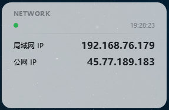

# DesktopDashboard UI/UX 设计规范

## 设计理念

遵循 **Apple Human Interface Guidelines**，追求：
- **简洁** — 去除一切不必要的装饰
- **自然** — 半透明、模糊效果营造空间感
- **克制** — 信息密度适中，留白充足
- **一致** — 统一的视觉语言贯穿始终

## 色彩规范

### 主色板

| 用途 | 色值 | 说明 |
|------|------|------|
| 背景 | `rgba(255,255,255,0.85)` | 毛玻璃白底 |
| 主文字 | `#1d1d1f` | Apple 深灰 |
| 次要文字 | `#86868b` | Apple 浅灰 |
| 强调色 | `#007AFF` | Apple 蓝 |
| 成功 | `#34C759` | 绿色 |
| 警告 | `#FF9500` | 橙色 |
| 错误 | `#FF3B30` | 红色 |

### 暗色主题

| 用途 | 色值 |
|------|------|
| 背景 | `rgba(30,30,34,0.85)` |
| 主文字 | `#f5f5f7` |
| 次要文字 | `#8e8e93` |
| 强调色 | `#0A84FF` |

## 字体规范

### 字体选择

| 平台 | 字体 | 回退 |
|------|------|------|
| macOS | SF Pro Text | - |
| Windows | Segoe UI | - |
| Linux | Ubuntu | Noto Sans |

### 字号层级

| 用途 | 大小 | 字重 | 行高 |
|------|------|------|------|
| 标题 | 11px | 600 | 1.2 |
| 标签 | 11px | 500 | 1.2 |
| 数值 | 16px | 600 | 1.2 |
| 提示 | 12px | 500 | 1.2 |
| 时间 | 11px | 500 | 1.2 |

### 字体栈

```css
font-family: -apple-system, BlinkMacSystemFont, "SF Pro Text",
             "Segoe UI", "Ubuntu", "Noto Sans", sans-serif;
```

## 间距规范

### 基础单位

- 基础间距：`4px`
- 小间距：`4px`、`6px`
- 中间距：`8px`、`12px`
- 大间距：`16px`、`20px`、`24px`

### 组件间距

| 元素 | 间距 |
|------|------|
| 窗口内边距 | 20px |
| 标题行间距 | 6px |
| 分隔线边距 | 4px |
| 内容块间距 | 8px |
| 状态栏间距 | 6px |

## 圆角规范

| 元素 | 圆角 |
|------|------|
| 窗口 | 16px |
| 状态指示器 | 4px |
| Toast 提示 | 8px |
| 菜单项 | 4px |
| 复制按钮 | 12px（悬停时） |

## 阴影规范

### 窗口阴影

```css
box-shadow: 0 2px 12px rgba(0, 0, 0, 0.08);
```

### 菜单阴影

```css
box-shadow: 0 4px 16px rgba(0, 0, 0, 0.12);
```

### 悬停效果

```css
background: rgba(0, 0, 0, 0.06);
border-radius: 12px;
```

## 动画规范

### 持续时间

| 类型 | 时长 | 缓动 |
|------|------|------|
| 快速 | 0.15s | ease-out |
| 标准 | 0.3s | ease-in-out |
| 慢速 | 0.5s | ease-in-out |

### 动效列表

| 场景 | 动效 |
|------|------|
| 窗口显示 | 淡入 + 轻微上移 |
| Toast 提示 | 淡入 → 保持 2s → 淡出 |
| 菜单展开 | 向上滑入 + 淡入 |
| 状态指示器 | 颜色过渡 |

## 布局规范

### 窗口尺寸

- 默认：280×180px
- 最小：240×160px
- 最大：320×200px

### 内容布局

```
┌──────────────────────────────┐
│ ● NETWORK              14:32 │  ← 标题行
│                              │
│ ──────────────────────────── │  ← 分隔线
│                              │
│ LAN IP                       │
│ 192.168.1.100    📋          │  ← 内容块
│                              │
│ Public IP                    │
│ 203.0.113.42     📋          │  ← 内容块
│                              │
└──────────────────────────────┘
```


### 响应式原则

- 窗口大小固定，内容自适应
- IP 值右对齐，标签左对齐
- 复制按钮始终在 IP 值右侧

## 交互反馈

### 鼠标悬停

| 元素 | 反馈 |
|------|------|
| 复制按钮 | 显示图标 + 背景色变化 |
| 菜单项 | 蓝色高亮背景 |
| 窗口 | 无变化（保持简洁） |

### 点击反馈

| 操作 | 反馈 |
|------|------|
| 复制 IP | 显示"已复制"Toast |
| 菜单选项 | 立即执行，无动画 |
| 拖拽窗口 | 鼠标样式变化 |

### 状态指示

| 状态 | 指示器颜色 |
|------|-----------|
| 正常 | `#34C759`（绿） |
| 警告 | `#FF9500`（橙） |
| 错误 | `#FF3B30`（红） |

## 无障碍规范

- 文字与背景对比度 ≥ 4.5:1
- 可点击元素尺寸 ≥ 24×24px
- 支持键盘导航（Tab 键）
- 语义化标签（label/value 分离）

## 资源文件

### 图标

| 文件 | 用途 | 尺寸 |
|------|------|------|
| icon.svg | 系统托盘图标 | 1024×1024 |
| copy.svg | 复制按钮图标 | 1024×1024 |
| pinned.svg | 固定状态图标 | 1024×1024 |

### 图标规范

- 格式：SVG
- 颜色：主色 `#007AFF`，次要色 `#999999`
- 风格：线性图标，2px 描边
-  viewBox：0 0 1024 1024

## 设计检查清单

开发完成前确认：
- [ ] 色彩符合规范
- [ ] 间距统一
- [ ] 圆角正确
- [ ] 字体层级清晰
- [ ] 阴影层次合理
- [ ] 动效流畅
- [ ] 响应式适配
- [ ] 无障碍达标
