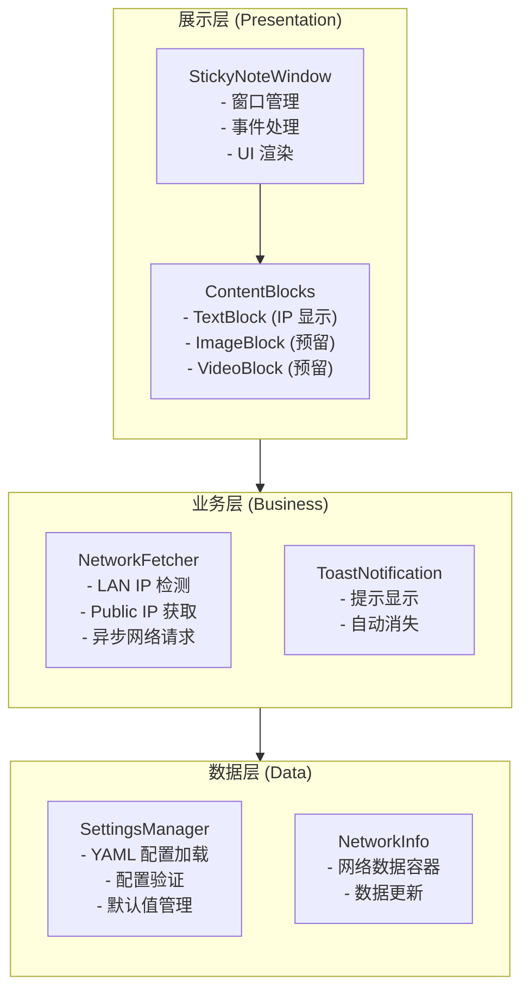
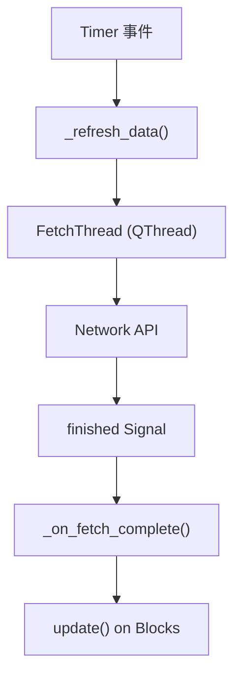
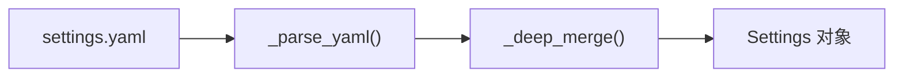
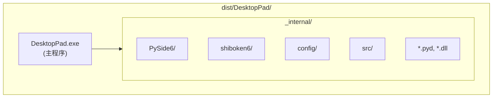

# DesktopPad 技术架构说明

## 概述

DesktopPad 采用**分层架构** + **插件化内容块**设计，实现高内聚、低耦合的模块化系统。

## 架构图



## 模块设计

### 核心模块

#### 1. `widget.py` - 窗口核心

**职责：**
- 管理主窗口生命周期
- 内容块编排
- 事件处理（拖拽、右键菜单、鼠标悬停）
- 与业务层交互

**关键类：**
- `StickyNoteWindow` — 主窗口
- `TextBlock` — 文本内容块
- `ToastLabel` — Toast 提示

**依赖：**
- config.Settings
- fetcher.NetworkInfo
- style.QSS 样式表

#### 2. `fetcher.py` - 网络信息获取

**职责：**
- LAN IP 检测（socket 探测）
- Public IP 获取（HTTP API）
- 异步网络请求

**关键类：**
- `FetchThread` — 后台线程
- `NetworkInfo` — 数据容器

**设计要点：**
- 使用 QThread 避免阻塞 UI
- 超时处理（5 秒）
- 多协议回退（HTTPS → HTTP）

#### 3. `config.py` - 配置管理

**职责：**
- YAML 配置文件加载
- 配置验证
- 默认值管理
- 配置合并（用户配置 + 默认值）

**关键类：**
- `Settings` — 配置数据类
- `DisplaySettings` — 显示配置
- `AppearanceSettings` — 外观配置
- `RefreshSettings` — 刷新配置
- `WindowSettings` — 窗口行为配置

**数据流：**
```
settings.yaml → load_settings() → Settings 对象
```

#### 4. `style.py` - 样式管理

**职责：**
- 提供 QSS 样式表
- 亮色/暗色主题
- 苹果风格设计实现

**关键函数：**
- `get_stylesheet(theme: str) → str`

## 数据流

### 网络信息更新流程



### 配置加载流程



## 设计模式

### 1. 插件化内容块（Plugin Architecture）

**模式：** 策略模式 + 工厂模式

```python
class ContentBlock:
    """内容块基类"""
    def render(self) -> QWidget: ...
    def update(self, data: NetworkInfo) -> None: ...

class TextBlock(ContentBlock):
    """文本内容块"""
    ...

class ImageBlock(ContentBlock):
    """图片内容块（未来）"""
    ...
```

**优点：**
- 新增内容类型无需修改现有代码
- 内容块独立测试
- 灵活组合显示

### 2. 信号 - 槽（Signal-Slot）

**模式：** 观察者模式

```python
class FetchThread(QThread):
    finished = Signal(NetworkInfo)  # 信号定义

# 使用
thread.finished.connect(on_data_received)
```

**优点：**
- 解耦网络请求和 UI 更新
- 线程安全
- 易于扩展

### 3. 配置合并

**模式：** 模板方法 + 策略

```python
DEFAULTS = { ... }  # 默认配置
merged = _deep_merge(DEFAULTS, user_config)
```

**优点：**
- 用户可覆盖任意配置
- 默认值保护
- 配置可验证

## 扩展点

### 1. 新增内容块

在 `src/app/widget.py` 中：

```python
class NewBlock(ContentBlock):
    def __init__(self, parent):
        ...

    def update(self, data: NetworkInfo):
        ...
```

在 `StickyNoteWindow._init_blocks()` 中注册。

### 2. 新增网络数据源

在 `src/app/fetcher.py` 中：

```python
def get_custom_data() -> str:
    ...
```

在 `NetworkInfo` 中添加字段。

### 3. 新增主题

在 `src/app/style.py` 中：

```python
CUSTOM_THEME = r"""..."""

def get_stylesheet(theme: str) -> str:
    if theme == "custom":
        return CUSTOM_THEME
    ...
```

## 性能考虑

### 1. 网络请求

- 使用后台线程（QThread）
- 超时设置（5 秒）
- 异步信号通知

### 2. UI 渲染

- 最小化重绘
- 使用 QSS 批量样式
- 避免频繁设置样式

### 3. 内存管理

- 单例配置对象
- 复用内容块实例
- 及时清理定时器

## 跨平台兼容

### Windows
- 系统托盘图标
- 窗口置顶
- 拖拽支持

### macOS
- NSVisualEffectView 集成
- 毛玻璃效果
- 菜单栏集成

### Linux
- Unity/KDE/GNOME 兼容
- 系统托盘（Systray）
- 窗口管理器兼容

## 部署架构



**打包命令：**
```bash
pyinstaller --onedir --windowed --hidden-import PySide6.QtCore ...
```

## 未来演进

### 短期
- [ ] 图片显示支持
- [ ] 视频播放支持
- [ ] 深色主题完善

### 中期
- [ ] LVGL 控件集成
- [ ] 插件市场
- [ ] 主题商店

### 长期
- [ ] 云同步配置
- [ ] 小组件市场
- [ ] Web 组件支持
