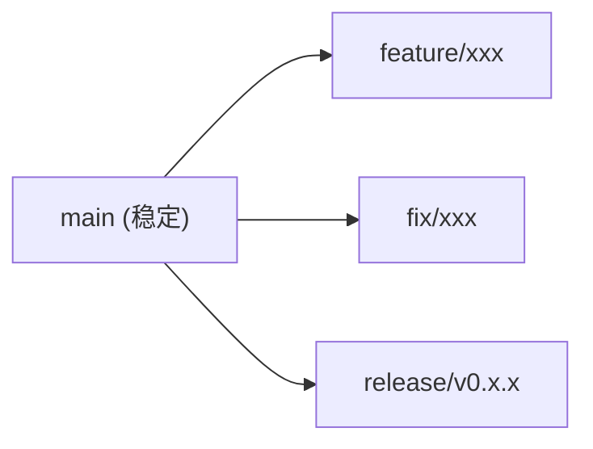

# DesktopDashboard 开发规范

## 代码风格

### Python 规范

遵循 **PEP 8** 并补充以下约定：

#### 1. 导入顺序

```python
# 标准库
import os
import sys
from pathlib import Path

# 第三方库
from PySide6.QtCore import Qt, QThread, Signal

# 本地模块
from .config import Settings
from .fetcher import NetworkInfo
```

#### 2. 类型提示

**所有函数和方法必须使用类型提示：**

```python
def fetch_lan_ip() -> str:
    """获取局域网 IP。
    
    Returns:
        str: 局域网 IP 地址
    """
    ...
```

#### 3. 文档字符串

**使用 Google 风格文档字符串：**

```python
class FetchThread(QThread):
    """后台网络请求线程。
    
    Attributes:
        finished: 数据获取完成信号
    
    Args:
        public_ip_url: 公网 IP API 地址
    """
    
    def run(self) -> None:
        """执行网络请求。
        
        Raises:
            TimeoutError: 请求超时
        """
        ...
```

#### 4. 命名规范

| 类型 | 规范 | 示例 |
|------|------|------|
| 模块 | snake_case | `widget.py` |
| 类 | PascalCase | `StickyNoteWindow` |
| 函数 | snake_case | `load_settings()` |
| 常量 | UPPER_CASE | `DEFAULT_TIMEOUT` |
| 私有属性 | _private | `_network_info` |
| 公共属性 | public | `settings` |

#### 5. 代码长度

- 单行最大长度：120 字符
- 单函数最大行数：50 行
- 单文件最大行数：300 行

## 文件组织

### 目录结构

```mermaid
graph LR
    src["src/"]
    src --> init_py["__init__.py<br/>(包初始化)"]
    src --> main_py["main.py<br/>(入口点)"]
    src --> app["app/"]
    src --> tests["tests/<br/>(测试目录)"]

    app --> app_init["__init__.py"]
    app --> widget["widget.py<br/>(窗口核心)"]
    app --> config["config.py<br/>(配置管理)"]
    app --> fetcher["fetcher.py<br/>(网络请求)"]
    app --> style["style.py<br/>(样式管理)"]
    app --> icons["icons/<br/>(图标资源)"]
    app --> ext["ext/<br/>(扩展目录)"]
```

### 测试命名

```python
def test_load_settings_with_valid_file():
    """测试有效配置文件的加载"""
    ...

def test_load_settings_with_missing_file():
    """测试缺失配置文件使用默认值"""
    ...
```

### 测试原则

1. **单元测试** — 测试单个函数/类
2. **集成测试** — 测试模块交互
3. **端到端测试** — 测试完整流程

## 错误处理

### 原则

1. **不吞掉异常** — 至少记录日志
2. **提供上下文** — 错误信息清晰
3. **优雅降级** — 失败时显示合理默认值

### 示例

```python
try:
    ip = get_public_ip(url)
except TimeoutError:
    logger.warning(f"Public IP request timed out for {url}")
    ip = "N/A"
except Exception as e:
    logger.error(f"Failed to get public IP: {e}")
    ip = "N/A"
```

## 安全规范

### 配置安全

- 不存储敏感信息（密码、密钥）
- 配置文件不提交到 Git
- 使用环境变量处理敏感数据

### 网络安全

- 验证 API 响应
- 设置请求超时
- 使用 HTTPS

## 性能规范

### 内存管理

- 避免全局变量
- 及时释放资源
- 使用生成器处理大数据

### UI 性能

- 最小化重绘
- 使用 QSS 批量样式
- 避免在主线程执行耗时操作

## 跨平台规范

### 路径处理

```python
from pathlib import Path

# 正确
path = Path(__file__).resolve().parent / "config"

# 错误
path = os.path.join(__file__, "config")
```

### 平台检测

```python
import sys

if sys.platform == "win32":
    # Windows 特定代码
elif sys.platform == "darwin":
    # macOS 特定代码
else:
    # Linux 特定代码
```

## 协作流程

### 分支策略



### 代码审查

1. 创建 Pull Request
2. 自动检查（lint、test）
3. 至少 1 人审查
4. 审查通过后合并

### 审查要点

- [ ] 功能完整
- [ ] 代码风格一致
- [ ] 类型提示完整
- [ ] 文档更新
- [ ] 测试覆盖
- [ ] 性能影响
- [ ] 安全性

## 工具链

### 推荐工具

| 工具 | 用途 |
|------|------|
| Black | 代码格式化 |
| flake8 | 代码检查 |
| mypy | 类型检查 |
| pytest | 测试框架 |
| pre-commit | Git 钩子 |

### 配置示例

**.pre-commit-config.yaml**
```yaml
repos:
  - repo: https://github.com/psf/black
    rev: 23.1.0
    hooks:
      - id: black
  - repo: https://github.com/pycqa/flake8
    rev: 6.0.0
    hooks:
      - id: flake8
```

## 变更管理

### 版本更新检查清单

- [ ] 更新版本号
- [ ] 更新 CHANGELOG.md
- [ ] 更新 README.md
- [ ] 运行完整测试
- [ ] 更新依赖版本
- [ ] 重新构建打包
- [ ] 更新文档
